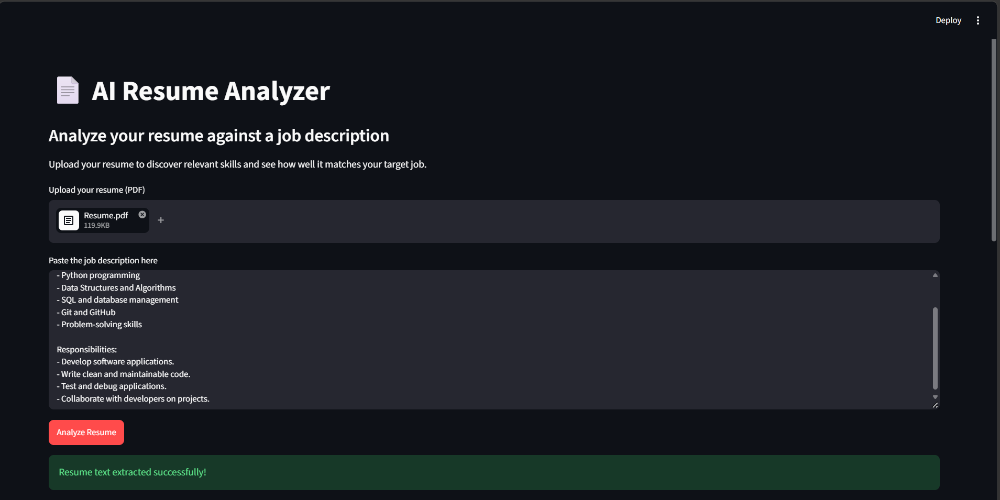
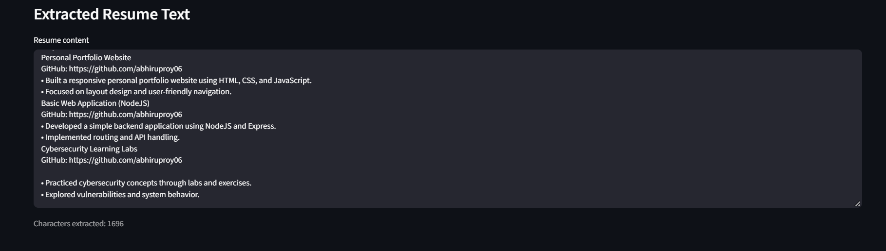
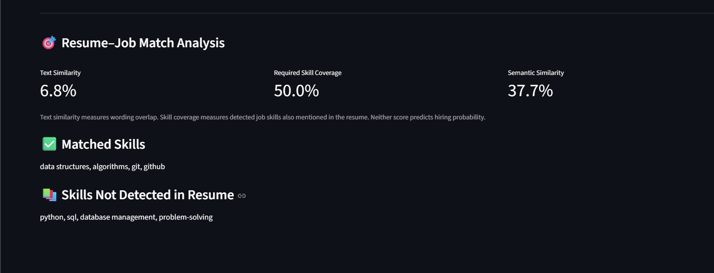

# 📄 AI Resume Analyzer

An AI-powered resume analysis tool that compares a candidate's resume against a job description using text similarity, semantic similarity, and skill-gap analysis.

The application helps users identify relevant skills, understand potential gaps, and improve how they present their qualifications for a target role.
## 🖥️ Application Screenshots

### 1. Resume Upload and Job Description



### 2. Extracted Resume Text



### 3. Resume Matching and Skill Gap Analysis




## 🚀 Features

* **PDF Resume Parsing:** Extract readable text from uploaded PDF resumes.
* **Text Similarity:** Uses TF-IDF and cosine similarity to compare resume text with a job description.
* **Semantic Similarity:** Uses a pretrained Sentence Transformers model to compare the meaning of resume and job-description text.
* **Skill Detection:** Identifies predefined technical skills in resumes and job descriptions.
* **Skill-Gap Analysis:** Highlights required skills that were not detected in the resume.
* **Resume Improvement Suggestions:** Provides rule-based recommendations to help users improve their resumes.

## 🛠️ Tech Stack

* **Language:** Python
* **Frontend:** Streamlit
* **PDF Processing:** PyMuPDF
* **Text Similarity:** Scikit-learn, TF-IDF, Cosine Similarity
* **Semantic Similarity:** Sentence Transformers
* **Model:** `all-MiniLM-L6-v2`

## ⚙️ Getting Started

### Prerequisites

* Python 3.10 or a compatible Python version
* pip
* Internet access for installing dependencies and downloading the pretrained semantic model

### 1. Clone the repository

```bash
git clone https://github.com/abhiruproy06/ai-resume-analyzer.git
cd ai-resume-analyzer
```

### 2. Create a virtual environment

**Windows:**

```powershell
python -m venv .venv
.venv\Scripts\activate
```

### 3. Install dependencies

```bash
python -m pip install -r requirements.txt
```

### 4. Run the application

```bash
python -m streamlit run app.py
```

Open the local URL displayed in the terminal to access the application.

## 📖 How It Works

1. Upload a resume in PDF format.
2. Paste the target job description.
3. Click **Analyze Resume**.
4. View the extracted resume text.
5. Review text similarity and semantic similarity scores.
6. Examine matched skills and skills not detected in the resume.
7. Read the resume improvement suggestions.

## 📊 Understanding the Results

* **Text Similarity:** Measures textual overlap using TF-IDF and cosine similarity.
* **Semantic Similarity:** Measures similarity between text embeddings generated by the pretrained sentence-transformer model.
* **Required Skill Coverage:** Measures the proportion of recognized job-description skills that were also detected in the resume.
* **Matched Skills:** Lists recognized skills found in both texts.
* **Skills Not Detected:** Lists recognized job-description skills that were not found in the resume.

**Note:** These metrics are indicative, not hiring probabilities. Skill detection is based on a predefined vocabulary and does not verify actual proficiency. A skill may be present in a resume but remain undetected because of wording or parsing limitations.

## 🔮 Future Improvements

* More comprehensive skill extraction
* Context-aware resume improvement recommendations
* Resume section and formatting analysis
* Interactive charts and visualizations
* Downloadable analysis reports
* Automated testing and evaluation against sample resumes

## 🔒 Privacy

Use caution when uploading resumes containing personal information. Do not commit resumes, personal documents, API keys, passwords, or other sensitive information to the repository.

## 👨‍💻 Author

**Abhirup Roy**

GitHub: [@abhiruproy06](https://github.com/abhiruproy06)

## 📄 License

No license has been specified yet. If you intend to make the project open source, consider adding an appropriate license.
